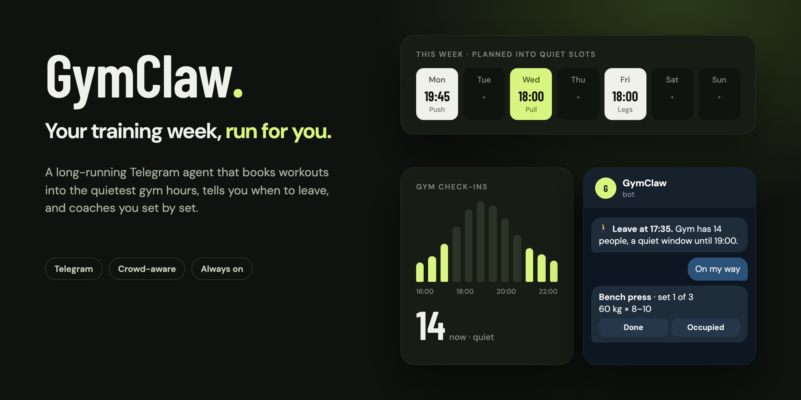
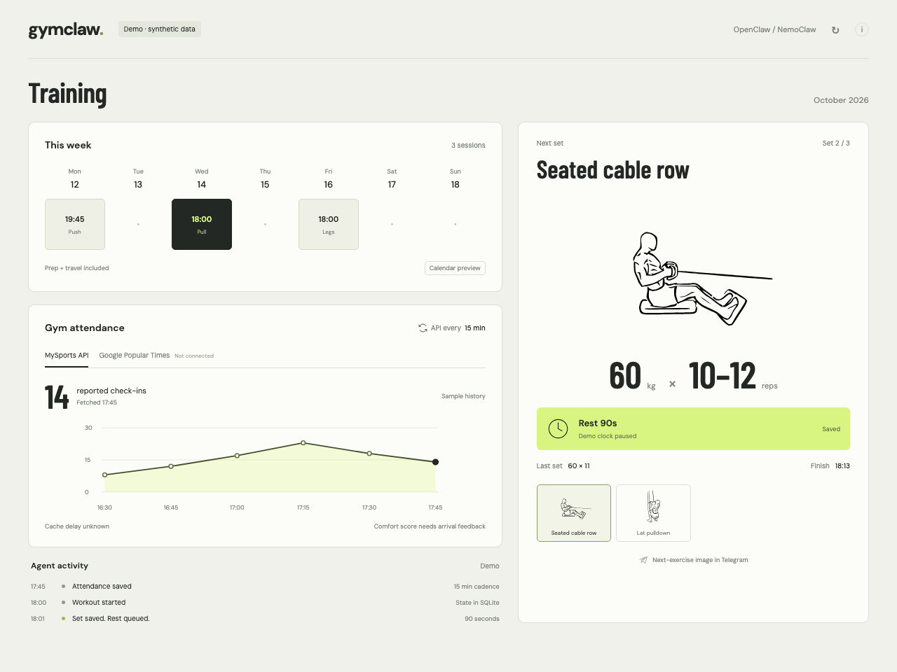

# GymClaw

A Telegram agent that plans my gym week around my calendar and the gym's crowd, tells me when to leave, and coaches me through each workout set by set.

> **Status: work in progress.** I use it daily. Expect rough edges and breaking changes.

## What it does

- **Plans** the week into the quietest gym slots that fit my calendar and rest days. Replans when meetings, trips or sick days get in the way, or when I say so in chat.
- **Reminds** me to get ready and when to leave, with the current crowd. Asks once if I don't show up.
- **Coaches** during the workout: exercise image, target, `✅ 10 × 80 kg` buttons or typed `10x80`, rest countdown, swap to a same-muscle alternative. No model in that loop.
- **Progresses** targets when all reps are hit, and sends a weekly review and plan every Sunday.
- **Tracks weight** from scale photos.

Onboarding happens in the same chat: a short interview, then a photo of an existing plan or a generated one.

## How it works

One Rust binary, `gymclaw` ([how it's built](docs/rust-runtime.md)):

- **Typed tools** own all state in SQLite (plans, sets, crowd history, outbox) and validate every action. The agent and `gymclaw call` use the same tools.
- **The agent** (GLM via OpenRouter) handles conversation and judgment calls with those tools and nothing else.
- **A native scheduler** runs the deterministic jobs: calendar sync every 60 s, crowd polling every 15 min, reminders, rest timers, the Sunday plan.
- **The coach** handles workout taps and typed sets without a model.
- Proactive messages go through an outbox with delivery receipts; actions carry request IDs so retries are safe.

## Running your own

Early as it is, it works. You need a Telegram bot, an OpenRouter key, a Google calendar and, for crowd-aware planning, a gym check-in source ([crowd data](docs/crowd.md)). Then `docker compose up` and follow [self-hosting](docs/self-hosting.md).

## License

MIT. Exercise art from [Workout Guide](https://github.com/bryllim/workout-guide).
